# Claude + Salesforce hosted MCP: fix "Authorization failed" and other connector errors (tested Oct 2026)

I tested all of this on 12 October 2026 with one free Salesforce Developer Edition org, claude.ai in a browser and a Claude Max account. I did not test sandboxes, production orgs, Claude Team or Enterprise owner flows, or Claude Desktop.

Claude's errors are generic and one message can have several causes. Below, `<name>` is your connector's name. Most messages end with "If this persists, share this reference with support: ofid_...". Keep that reference and the time you tried. In my screenshots I blurred support references and hid usernames and source IPs.

## If you're seeing one of these

### Couldn't register

"Couldn't register with `<name>`'s sign-in service. You can try again, or add an OAuth Client ID in the connector settings."

Claude pre-selects "Register automatically (DCR)" for the Salesforce URL and marks it "Detected". Salesforce does not register the client. Remove the connector, add it again with "Use your own OAuth client" and paste your External Client App's Consumer Key. That got me through the Salesforce sign-in.

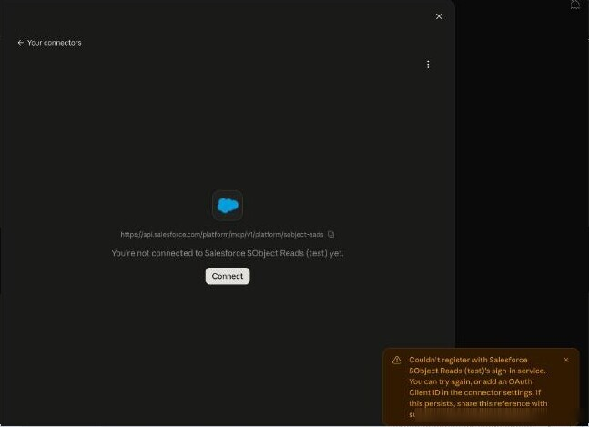

*The DCR error.*

That connector also had a URL typo (sobject-eads), but the error comes before any MCP call, so the typo didn't cause it. Someone in anthropics/claude-ai-mcp#1114 says only an Owner can add the client ID on Claude Team and Enterprise. I haven't tested that.

### Authorization failed, no tools

"Authorization with `<name>` failed. You can check your credentials and permissions." The connector page may show a Disconnect button, so it looks connected, plus "This connector has no tools available."

My cause was "Issue JSON Web Token (JWT)-based access tokens for named users" being off. A new External Client App has it off and issues opaque tokens. I turned it off and got this error; I turned it on and it connected. Fix: External Client App > Settings > Edit > OAuth Settings > Security, tick the JWT setting, Save. Then Disconnect and Connect in Claude.

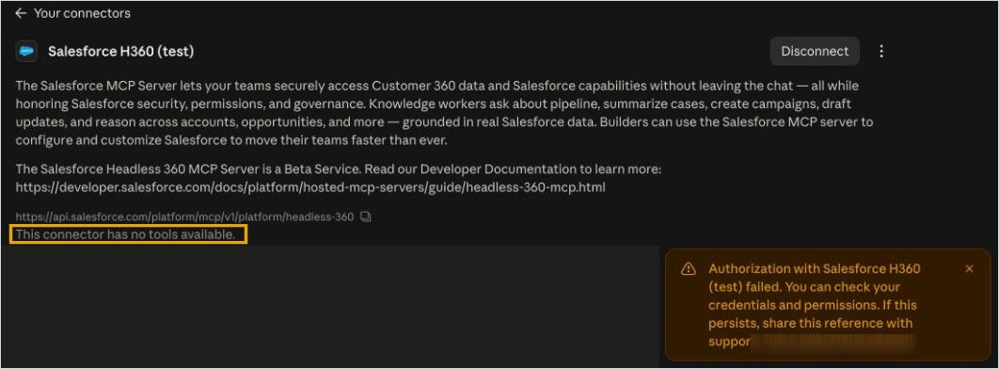

*Recaptured with JWT off on 12 Oct 2026, and turning it back on fixed it again.*

I reproduced a second cause too: "Require secret" on while Claude has no client secret. Login History shows "Failed: Missing Consumer Key Parameter", and the connector page may say "Your connection to `<name>` stopped working" instead of "no tools available". It was first reported in anthropics/claude-ai-mcp#1070. Untick "Require secret for Web Server Flow" and "Require secret for Refresh Token Flow", keep PKCE, wait a few minutes, then Disconnect and Connect.

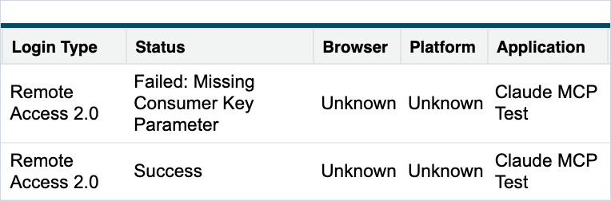

*Login History with "Require secret" on.*

I also got this message once with a mistyped URL path, but JWT was off in that run as well, so I can't say which fault caused it. Check the URL anyway.

The older wording was "Your account was authorized, but the integration rejected the credentials it just issued." Anthropic traced it to opaque tokens in anthropics/claude-ai-mcp#1093. I saw the newer wording in October.

### Authorized, but returned an error

"Your account was authorized, but `<name>` returned an error when connecting. You can try again, or check that the server is working." The connector page then shows "Connection issue. Couldn't connect to the server. Check that the URL points to a valid MCP server."

I got this pair from two faults. One was a wrong URL path, twice: `sobject-eads` (missing "r") and `headless360` (missing "-"), with JWT on both times. Remove the connector, add it again with the exact URL, then re-read the saved URL on the connector page.

The other was an inactive server. I deactivated Headless360 (H360), disconnected and connected my H360 connector, and got the same pair. Reactivating it fixed it: Setup > Integrations > API Catalog > MCP Servers, open the server, Activate, reconnect. Users of the "Salesforce - Beta" directory connector report the same fix (activate H360) in anthropics/claude-ai-mcp#933 and anthropics/claude-ai-mcp#495.

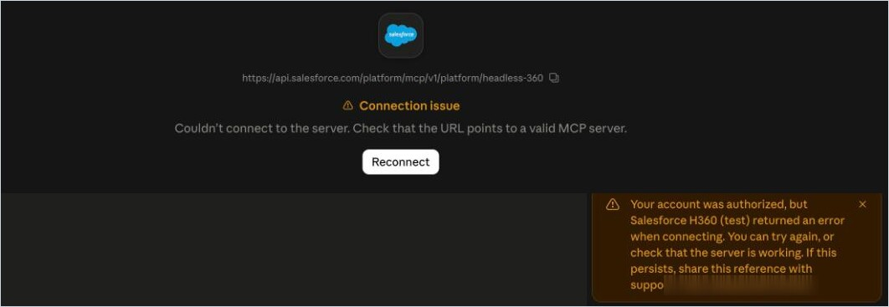

*H360 deactivated, which looks the same as a URL typo.*

A third cause I haven't tested is the server not being active for the org, or the user lacking MCP access. Anthropic traced older reports, with older wording, to Salesforce answering 404 or 405 on the first MCP call (anthropics/claude-ai-mcp#251 and anthropics/claude-ai-mcp#328).

## Checklist

If none of that matches, go through these in order.

1. Open the connector in Claude (in October 2026, Customize > Connectors > Yours) and read the saved URL one character at a time.
2. Check the connector uses "Use your own OAuth client" with your Consumer Key. Salesforce rejects the DCR option.
3. Tick "Issue JSON Web Token (JWT)-based access tokens for named users" in the External Client App.
4. Set the callback to `https://claude.ai/api/mcp/auth_callback` and the scopes to "Access Salesforce hosted MCP servers (mcp_api)" and "Perform requests at any time (refresh_token, offline_access)".
5. Leave "Require secret" off for the Web Server Flow and the Refresh Token Flow, unless you also paste the secret in Claude.
6. Activate the server named in your URL under Setup > Integrations > API Catalog > MCP Servers. All are inactive in a new org.
7. Wait a few minutes after a change, then Disconnect and Connect in Claude.
8. Read Setup > Login History, filtered to your app, around the time you tried. "Failed: ..." means the token exchange failed; "Success" means Salesforce issued a token and the failure came later.

Step 8 comes from anthropics/claude-ai-mcp#1070 and a comment on anthropics/claude-ai-mcp#1102. I did see "Success" rows while Claude still showed an error.

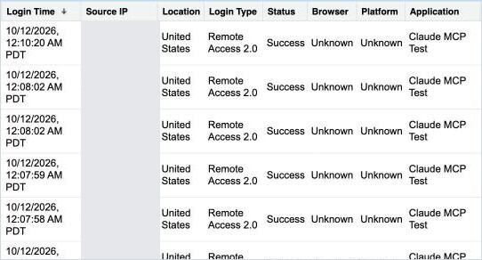

*Login History during my failing runs: "Remote Access 2.0", "Success", app "Claude MCP Test".*

## The setup that worked for me

### External Client App

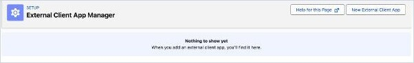

*Setup > External Client App Manager > New External Client App.*

| Setting | Value |
|---|---|
| Callback URL | `https://claude.ai/api/mcp/auth_callback` |
| OAuth scopes | `mcp_api` and `refresh_token` only |
| Require PKCE | On (locked on a new app) |
| Require secret for Web Server Flow | Off (the default) |
| Require secret for Refresh Token Flow | Off (the default) |
| Issue JWT-based access tokens for named users | On (default is off) |
| App Authorization / Permitted users | All users can self-authorize |

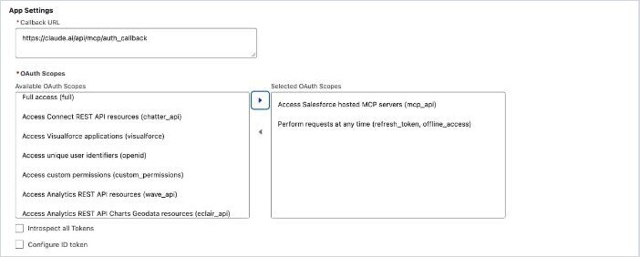

*The callback and the two scopes.*

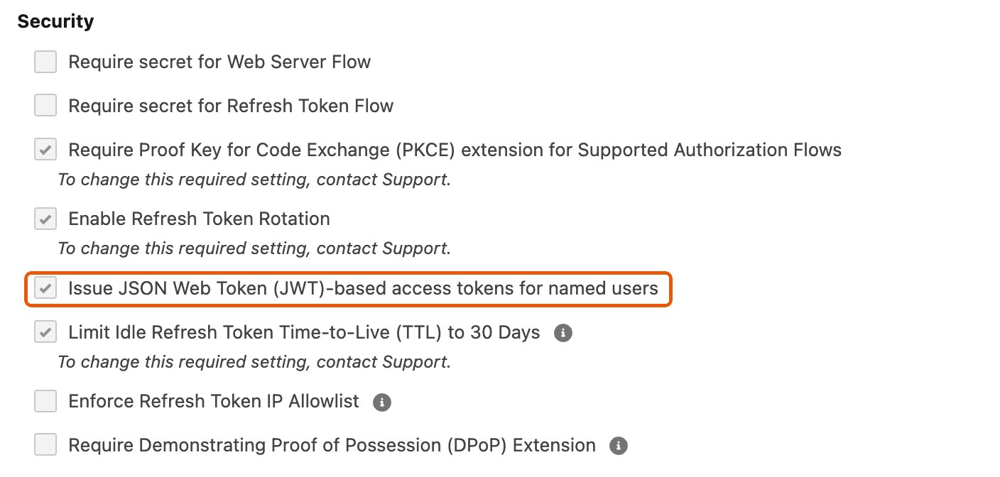

*The red box is the setting a new app leaves off.*

PKCE, refresh token rotation and the 30-day idle limit are locked on. Salesforce made me verify my identity with an email code before I could copy the Consumer Key.

### MCP servers

API Catalog > MCP Servers listed 16 servers in my org, all Inactive. I activated SObject Reads and Headless360 (H360).

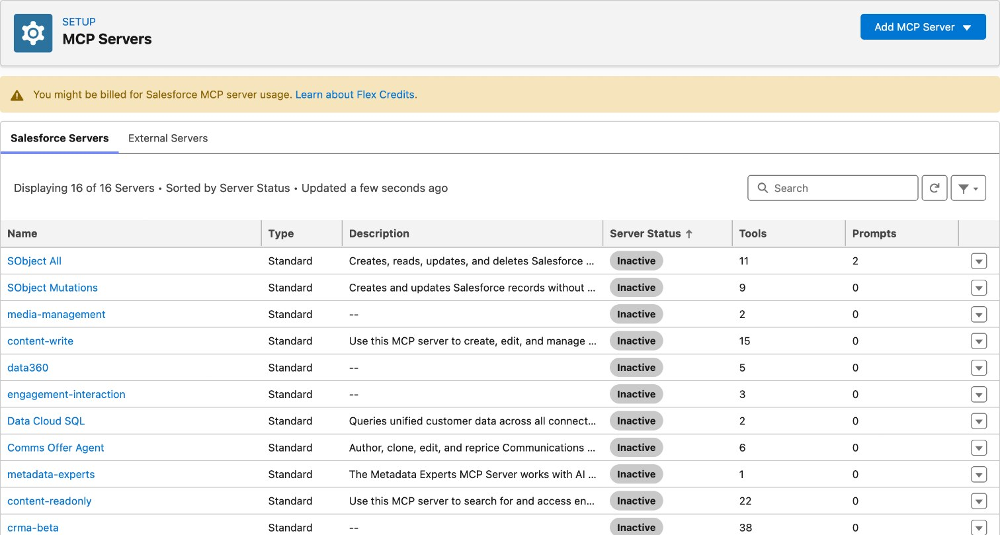

*In a new org every server starts Inactive. The Flex Credits banner sits on top.*

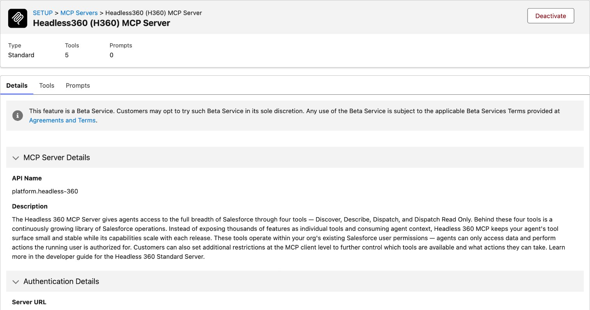

*The H360 page after Activate, with the Beta Services notice. The Server URL is under Authentication Details.*

H360 is marked Beta, and the page says activating it accepts Salesforce's Beta Services Terms. Read them before you click. I don't know yet whether SObject Reads alone works without H360 active.

### Claude connector

| Field | Value |
|---|---|
| URL | `https://api.salesforce.com/platform/mcp/v1/platform/headless-360` |
| OAuth client | "Use your own OAuth client" |
| Client ID | The External Client App's Consumer Key |
| Client secret | Empty |

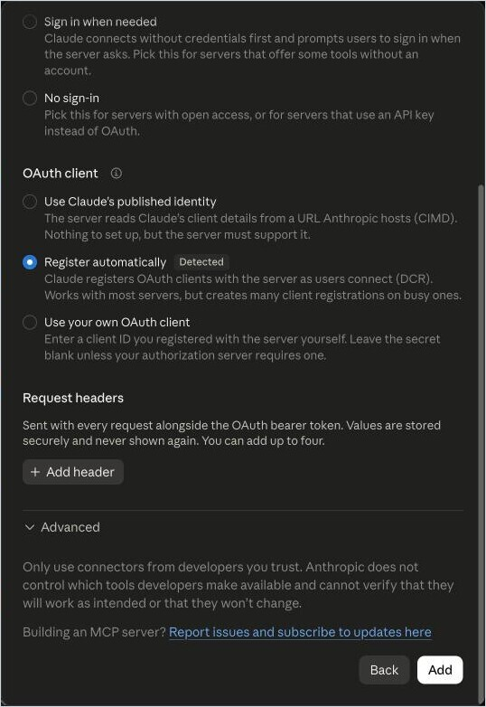

*Claude marks DCR "Detected"; pick "Use your own OAuth client".*

Salesforce's consent screen listed "Access the identity URL service" although I had only configured mcp_api and refresh_token.

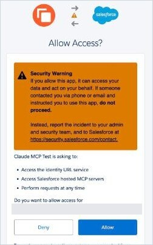

*The consent screen on first connect.*

Claude then said "Connected to Salesforce H360 (test)." and listed 5 tools: one interactive, three read-only, one write/delete. All defaulted to "Needs approval". So hosted MCP works on a free Developer Edition org.

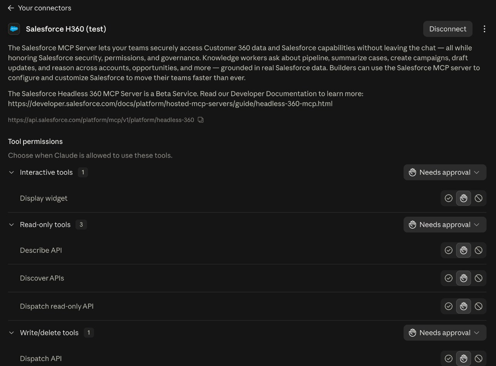

*Working looks like a Disconnect button plus a tool list.*

In a chat Claude asked to use "Discover APIs" and then "Dispatch read-only API" (GET `/services/data/v66.0/sobjects/Account/describe`), each needing "Allow once", and returned the Account object's fields.

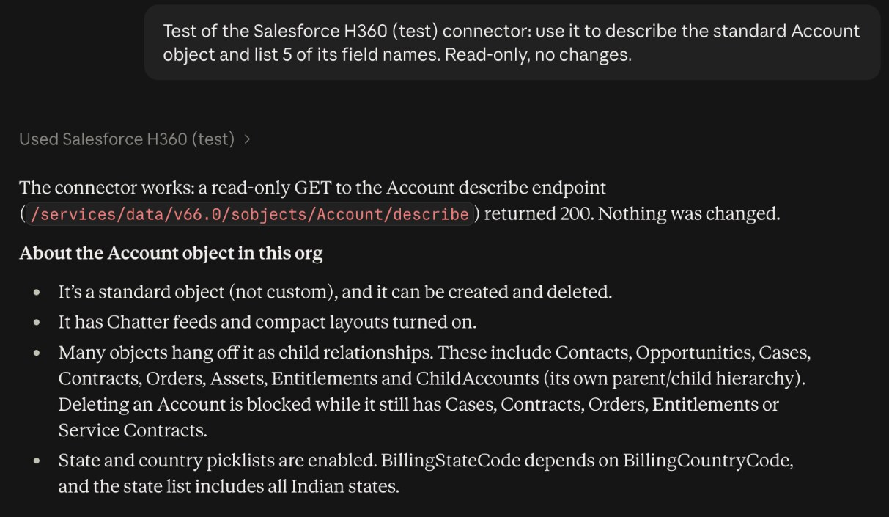

*Account describe returned 200 and nothing was changed.*

I didn't test the `sobject-reads` or `sobject-all` URLs with the exact path.

## Rarer errors

### "Your connection to `<name>` stopped working. Reconnect to continue."

I got this from the "Require secret" fault above, with an "Authorization with `<name>` failed" toast and "Failed: Missing Consumer Key Parameter" in Login History.

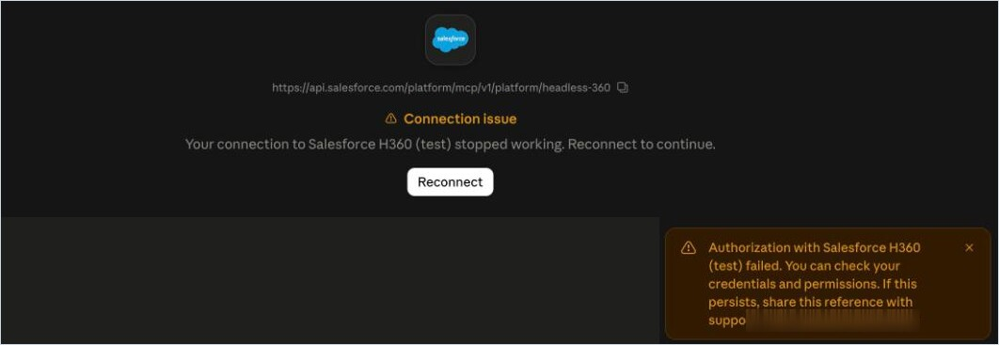

*"Require secret" on with no secret in Claude.*

I also saw it once in a run with a URL typo, an inactive server and JWT off together. Check Login History, then run the whole checklist.

### Other reported causes of "Authorization failed"

I haven't tested these.

- The Platform Integration User lost `C2CMcpServicePermSet`. Restore it (anthropics/claude-ai-mcp#495).
- The policy is "Admin approved users are pre-authorized" and the user isn't assigned. Assign them through a profile or permission set, or use self-authorize (forcedotcom/mcp-hosted#12). Anthropic suggested per-user access for new users in anthropics/claude-ai-mcp#839.
- The app has `api` or "Full" instead of `mcp_api` (anthropics/claude-ai-mcp#184, anthropics/claude-ai-mcp#1070).

### OAUTH_APPROVAL_ERROR_GENERIC on the Salesforce approval screen

A comment on anthropics/claude-ai-mcp#1070, and anthropics/claude-ai-mcp#527, blame wrong scopes such as only "Full" and say `mcp_api` and `refresh_token` fix it. Those are my working scopes, but I haven't seen them clear this error.

### "Couldn't reach the MCP server"

In anthropics/claude-ai-mcp#246 the saved URL had a stray character at the end, in one case a trailing backtick. Remove and re-add the connector with a clean URL.

### `invalid_client_id` at test.salesforce.com (sandbox)

I couldn't test sandboxes. In anthropics/claude-ai-mcp#986, still open with no fix in the thread, a sandbox with Enhanced Domains is sent to the legacy test.salesforce.com login and fails. Sandbox URLs use a `/sandbox/` path segment, and each URL path needs its own Consumer Key (anthropics/claude-ai-mcp#246, anthropics/claude-ai-mcp#1114).

### Connected, but tool calls fail

Two reports I haven't tested. "UNKNOWN_EXCEPTION" on queries came from High Assurance session security on the user's profile; remove it from the profile and grant it through a permission set (anthropics/claude-ai-mcp#329). "Unexpected error while invoking tool" across many users at once was a Salesforce incident in one case (a comment on anthropics/claude-ai-mcp#782).

### "Authentication required to use this tool", or signing in every week

Anthropic says to set the app's Refresh Token Policy to "valid until revoked" (anthropics/claude-ai-mcp#198). I haven't tried it.

### "A server with this URL already exists"

Claude allows one custom connector per URL, so two orgs can't share one (anthropics/claude-ai-mcp#614 and anthropics/claude-ai-mcp#178, both open).

## Things that surprised me

### A wrong URL path looks like a server problem

A wrong path never gave me "not found". I got the same generic errors as a server problem, and Login History still showed "Success" sign-ins.

- Production-style paths look like `https://api.salesforce.com/platform/mcp/v1/platform/<server>`. Copy the URL from the server's detail page in Setup, as I did for H360.
- Paths are case-sensitive, says a comment on anthropics/claude-ai-mcp#556.
- Watch for a trailing space or backtick (anthropics/claude-ai-mcp#184, anthropics/claude-ai-mcp#246).
- After you remove and re-add a connector, re-read the saved URL. A report in anthropics/claude-ai-mcp#556 says Claude brought back the old record with the old URL.

### Settings take a few minutes

An External Client App change I saved one minute earlier hadn't taken effect, and the same change tested eight minutes later had. I saw this once, so I don't know the exact delay.

### I couldn't find "Enable MCP Service"

Step 1 of Anthropic's Salesforce connector doc says to turn on "Enable MCP Service". I couldn't find a setting by that name in my Developer Edition org in October 2026. Setup search and the User Interface page showed nothing for "MCP Service". Activation happened per server under API Catalog > MCP Servers. I haven't checked other editions.

The same doc's callback, `http://127.0.0.1:53280/callback`, is for Claude Desktop managed configuration. On claude.ai my working callback was `https://claude.ai/api/mcp/auth_callback`.

### The Flex Credits banner

Once a server is active, the MCP Servers page says "You might be billed for Salesforce MCP server usage. Learn about Flex Credits." I don't know what a Developer Edition or production org is charged, so check your Salesforce contract before a wide rollout.

### Connectors are under Customize > Connectors > Yours, and the OAuth client is fixed

In October 2026 custom connectors sat under Customize > Connectors > Yours. Their ⋮ menu offers only "Remove", so I couldn't change the OAuth client choice or client ID after adding. Remove the connector and add it again. Anthropic's maintainers said the same in anthropics/claude-ai-mcp#1114.
